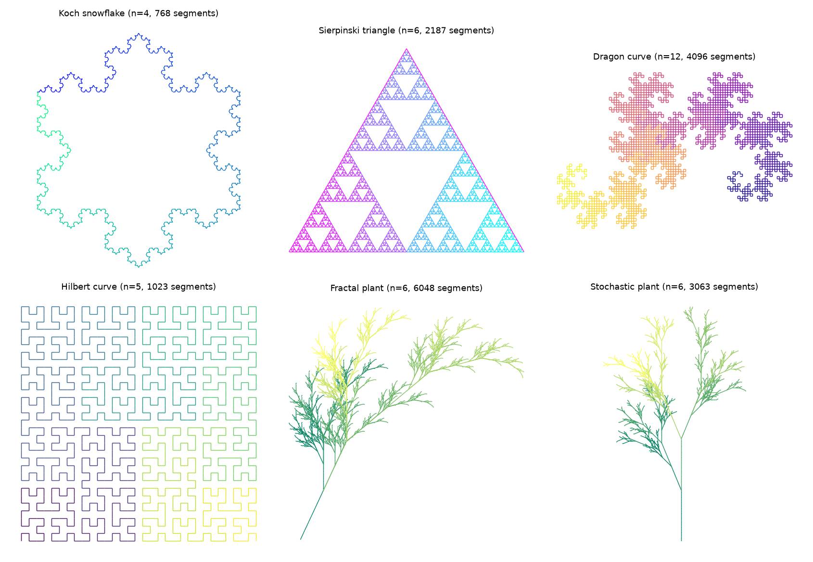

# lsystem-fractals

String-rewriting L-systems plus a small turtle that reads `F`/`G` (step forward and draw), `+`/`-` (turn) and `[`/`]` (push/pop state). Segments go to matplotlib as a single LineCollection. Presets cover the Koch snowflake, Sierpinski triangle, dragon curve, Hilbert curve and a fractal plant. A rule can also be a list of weighted options, which gives the stochastic plant.

## Setup

```
pip install -r requirements.txt
```

## Run

```
python lsystem.py              # writes gallery.png
python lsystem.py --seed 7     # different stochastic plant
```

## Test

```
python -m pytest -q
```

The tests check that the Koch string after n iterations has length 7·4^n, that the dragon curve draws exactly 2^n segments, that the snowflake closes, that brackets restore turtle state, and that stochastic rules depend on the seed.


